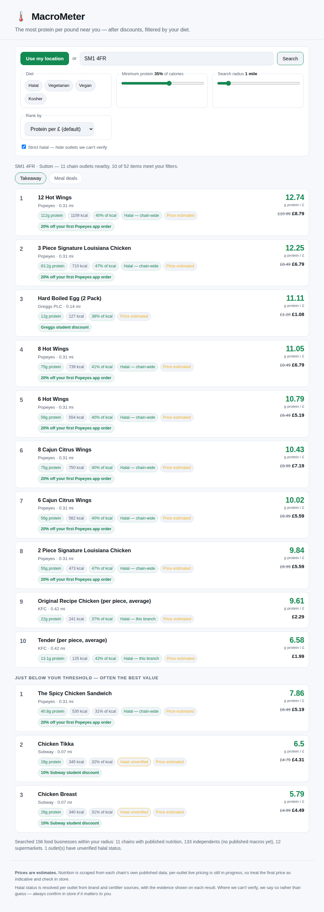

# MacroMeter 🌡️

*A thermometer for your macros.*

Find the **most protein per pound** near you — across fast food chains and supermarket meal deals — after every discount you're entitled to, filtered by your dietary requirements, with halal status resolved **per branch** rather than per chain.

```bash
pip install -r requirements.txt
python3 -m scripts.api.server          # http://localhost:8000
```

Enter any UK postcode (or hit "Use my location") and it ranks what's actually near you.



## What it does

| | |
|---|---|
| **Location** | Any UK postcode, or browser geolocation (Core Location on iOS Safari). Outlets discovered from the national FSA hygiene register — works anywhere, nothing is hardcoded to one town. |
| **Nutrition** | Live-scraped from each chain's own published data (McDonald's, Popeyes and Greggs APIs; KFC and Subway official PDFs). Plain HTTP, no browser automation. |
| **Halal** | Resolved **per outlet** from brand and certifier sources with explicit evidence tiers. Two Nando's in Sutton: one halal, one not — a chain-level flag can't express that. |
| **Discounts** | Modelled as rules with conditions (student platform, first app order), so the price shown is what you'd actually pay. |
| **Meal deals** | Fixed-price bundles optimised for maximum protein — often the best value of all (~12g protein/£ at Tesco). |

## Documentation

| Doc | What's in it |
|---|---|
| [Technical implementation plan](docs/TECHNICAL_IMPLEMENTATION_PLAN.md) | Architecture, data model, sources of truth, roadmap |
| [Data source registry](docs/DATA_SOURCES.md) | Every endpoint found, how it was found, and what's still blocked |
| [Halal verification design](docs/HALAL_VERIFICATION_DESIGN.md) | Why there's no halal API, and the evidence-tier resolver built instead |
| [Phase 0 results (SM1 4FR)](docs/PHASE0_SM1_4FR_RESULTS.md) | The hand-built dataset that validated the ranking, and what it got wrong |

## Command line

```bash
# scrape chain nutrition (Firestore if FIREBASE_CREDENTIALS is set, else local JSON)
python3 -m scripts.scrapers.run_all

# halal: prove the detection markers still discriminate, then resolve a location
python3 -m scripts.halal.cli verify
python3 -m scripts.halal.cli batch --postcode "M1 1AE" --radius 1

# build a chain's national store index (KFC: 949 stores, 206 halal)
python3 -m scripts.halal.cli build-index kfc

# supermarket meal deals
python3 -m scripts.mealdeals.cli fetch --retailers tesco,sainsburys,boots
python3 -m scripts.mealdeals.cli best --all --diet vegetarian
```

## Layout

```
scripts/
  geo/location.py        postcode/coords -> location -> nearby outlets (national)
  chains/store_index.py  per-chain national store indexes with coordinates
  scrapers/              chain nutrition adapters + Firestore/local sink
  halal/                 evidence-tiered per-outlet halal resolution
  mealdeals/             deal definitions, product ingestion, bundle optimiser
  api/                   scoring, discounts, prices, search, web server
web/                     the MacroMeter front end
data/db/                 scraped output and store indexes
```

## Honest limitations

- **Prices are estimates.** Chain prices are set per franchise and aren't centrally published; the per-store price adapters are the top of the backlog. Price moves the ranking more than nutrition does, so every estimate is labelled in the UI.
- **Halal gaps are shown as gaps.** Burger King and Subway vary per store with no per-outlet source yet, so they read "unverified — ask in store" rather than being guessed either way.
- **Meal-deal eligibility** comes from Open Food Facts categories, which know nutrition but not which products a shop will actually sell you inside a deal. Retailer eligibility lists are Phase 2b.
- **Independents have no macros.** They're under the UK calorie-labelling threshold, so they publish nothing. Photo/OCR ingestion is Phase 5.
